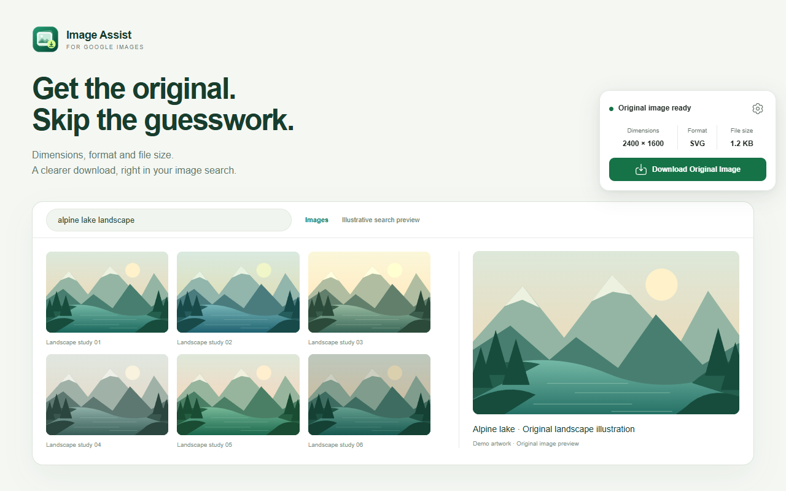
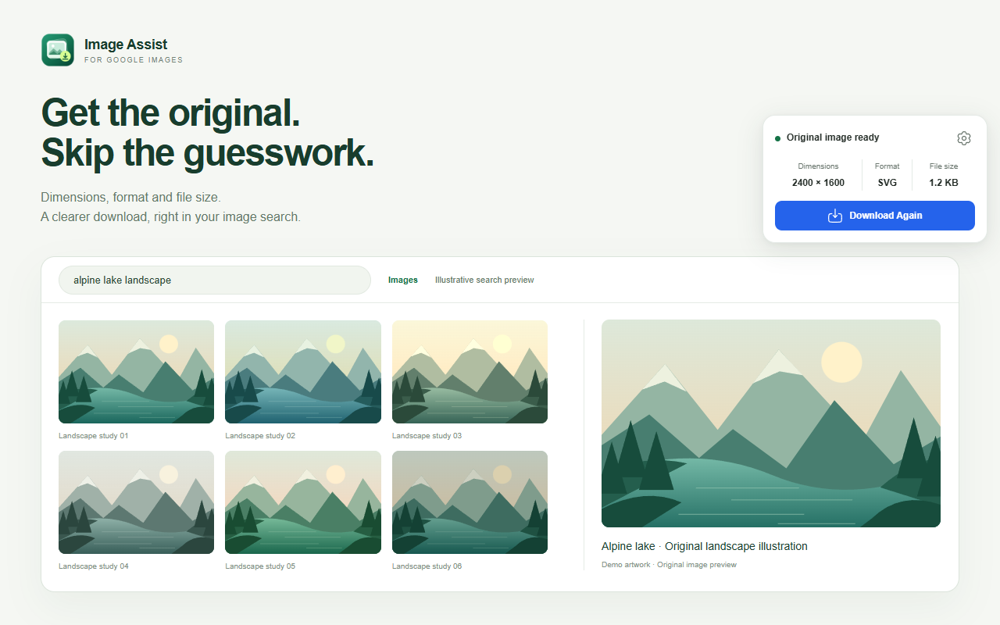
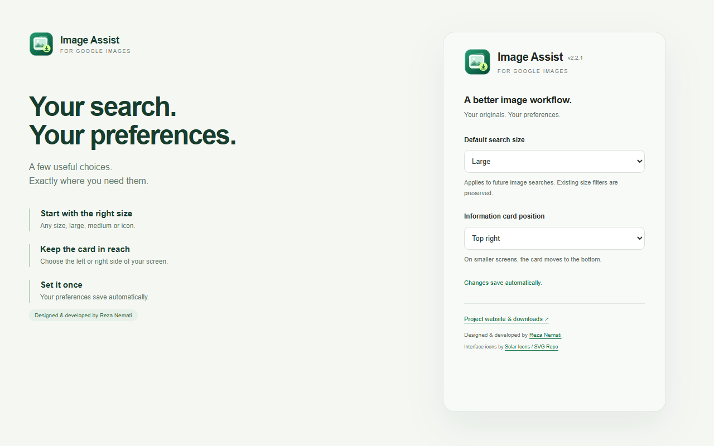

<div align="center">


# Image Assist for Google Images

**The original image. Without the guesswork.**

Check original image dimensions, format and file size. Save the original, recognize recent downloads, and make Google Images work your way.

[](https://github.com/mr-shady/google-image-assist/releases/latest)
[](https://github.com/mr-shady/google-image-assist/actions/workflows/ci.yml)
[](#chrome)
[](#firefox-142)
[](LICENSE)

[**Website & live demo**](https://mr-shady.github.io/google-image-assist/) · [**Download for Chrome**](https://github.com/mr-shady/google-image-assist/releases/latest/download/image-assist-chrome.zip) · [**Download for Firefox**](https://github.com/mr-shady/google-image-assist/releases/latest/download/image-assist-firefox.zip)

Designed & developed by **[Reza Nemati](https://reza-nemati.ir)**



</div>

## Why Image Assist?

Google Images can show a low-resolution thumbnail while the original is still loading. Saving too early can leave you with a small `images.jpg` instead of the image you wanted.

Image Assist adds a compact card to the image preview. It identifies the original URL, checks the original file when the host allows access, and gives you a clear download action.

## Features

| Feature | What it does |
| --- | --- |
| Original file details | Shows dimensions, format and actual response size instead of presenting thumbnail information as the original. |
| Direct download | Opens the browser's save dialog for the original image. Also available from the image context menu. |
| Recent download recognition | A green **Download Original Image** button becomes blue **Download Again** for a matching successful download from the last 30 days. |
| Search-size preferences | Choose unchanged, large, medium or icon. Explicit size parameters and other search filters are preserved. |
| Flexible appearance | Left/right placement, automatic light/dark themes, responsive layout and reduced-motion support. |
| Clear feedback | Waiting spinner, explicit errors and retry controls. Unknown information is never guessed. |
| Local preferences | No account, analytics or developer-operated collection server. |

Recent-download recognition uses the browser's local download history, including native **Save Image As** downloads. Matching is by original or final URL, not visual similarity. Cancelled or failed downloads do not qualify. Clearing download history removes the indicators; a marker does not prove the file is still on disk.

## Screenshots

| Download again | Settings |
| --- | --- |
|  |  |

Screenshots render the actual extension interface in an illustrative local environment. They are not captures of live Google search results. The [website demo](https://mr-shady.github.io/google-image-assist/) simulates the interface without downloading files.

## Installation

Packages are distributed through [GitHub Releases](https://github.com/mr-shady/google-image-assist/releases). They are not yet published in the Chrome Web Store or Firefox Add-ons store.

### Chrome

1. Download [image-assist-chrome.zip](https://github.com/mr-shady/google-image-assist/releases/latest/download/image-assist-chrome.zip) and extract it.
2. Open `chrome://extensions` and enable **Developer mode**.
3. Click **Load unpacked** and select the extracted folder containing `manifest.json`.
4. Refresh your Google Images tabs.

### Firefox 142+

1. Download [image-assist-firefox.zip](https://github.com/mr-shady/google-image-assist/releases/latest/download/image-assist-firefox.zip) and extract it.
2. Open `about:debugging#/runtime/this-firefox`.
3. Click **Load Temporary Add-on** and select the extracted `manifest.json`.
4. Refresh your Google Images tabs.

Temporary Firefox installations end when Firefox closes. Permanent installation in standard Firefox requires Mozilla signing; the GitHub package is unsigned.

To update, replace the extracted files, reload the extension and refresh Google Images. Disable older duplicate copies to avoid multiple cards.

## Settings

Click the toolbar icon or the settings icon in the image card. Preferences save automatically.

- **Default search size:** unchanged, large, medium or icon. Initial default: large. Applies to future searches without an explicit size filter.
- **Information card position:** top right or top left. On smaller screens the card moves to the bottom.
- **Installed version:** read directly from the extension manifest, alongside the project website and developer links.

## Privacy and permissions

The extension stores preferences locally and holds inspected metadata temporarily in memory. Image inspection requests the original file from its hosting website. There is no developer-operated endpoint receiving image files, search queries or download records.

| Permission | Purpose |
| --- | --- |
| `downloads` | Open save dialogs, check recent matching completed downloads and react to completion events. |
| `contextMenus` | Offer an original-image action on supported Google image-search pages. |
| `storage` | Save search-size and card-position preferences. |
| HTTP/HTTPS host access | Inspect original files hosted across different websites. Content scripts run only on `google.com/search`. |

Read the [privacy policy](https://mr-shady.github.io/google-image-assist/privacy.html) or its [source](store/PRIVACY.md).

## Limitations

- Supports image searches at `google.com/search` with `udm=2` or `tbm=isch`. Country-specific Google domains are not currently included.
- Some image hosts block extension requests. A browser-loaded original remains downloadable, while unverified format or size is shown as unavailable.
- Automatic inspection is limited to 40 MB and an 18-second network timeout.
- Inspection and download are separate requests; dynamically generated responses may differ.
- Google's page structure can change and require selector updates.
- Image Assist does not upscale images, remove watermarks or grant permission to reuse them.

## Development

Requires **Node.js 24+** and npm. No runtime framework or remotely hosted JavaScript is used.

```sh
git clone https://github.com/mr-shady/google-image-assist.git
cd google-image-assist
npm ci
npm test
npm run build
```

Load `dist/chrome` or `dist/firefox` using the installation steps above. `npm run build` also refreshes the website's shared demo assets and version metadata.

```text
background.js       File inspection, download relay and recent-download checks
content.js          Preview detection, information card and status handling
shared.js           URL, metadata and filename helpers
options.*           Settings interface
assets/             Original supplied interface SVGs
tests/              Helper, background and simulated-DOM tests
docs/               GitHub Pages website and interactive demonstration
store/              Screenshots, listing copy and privacy-policy source
```

Chrome uses a Manifest V3 service worker; Firefox uses background scripts. The original Firefox ID is retained for update compatibility.

Optional icon regeneration requires Python, CairoSVG and Pillow:

```sh
python generate-icons.py
```

Create installation ZIPs in PowerShell:

```powershell
Compress-Archive -Path dist/chrome/* -DestinationPath dist/image-assist-chrome.zip -Force
Compress-Archive -Path dist/firefox/* -DestinationPath dist/image-assist-firefox.zip -Force
```

Tests cover file parsing, filters, stale responses, recent-download matching, completion events, cancellation and settings. They use simulated browser APIs and do not certify Google's live markup or a real store installation. GitHub Actions runs the checks on pushes and pull requests.

## Feedback and contributing

Found a problem? [Open an issue](https://github.com/mr-shady/google-image-assist/issues) with your browser version, extension version and steps to reproduce it. Avoid including private image URLs or personal download paths.

For changes, create a branch, run `npm test` and `npm run build`, and open a pull request. See [CHANGELOG.md](CHANGELOG.md) for version history.

## License and credits

Original project code and artwork are available under the [MIT License](LICENSE). Solar interface icons have separate attribution and licensing described in [THIRD_PARTY.md](THIRD_PARTY.md).

Designed & developed by **[Reza Nemati](https://reza-nemati.ir)**.

Independent project; not affiliated with or endorsed by Google.
